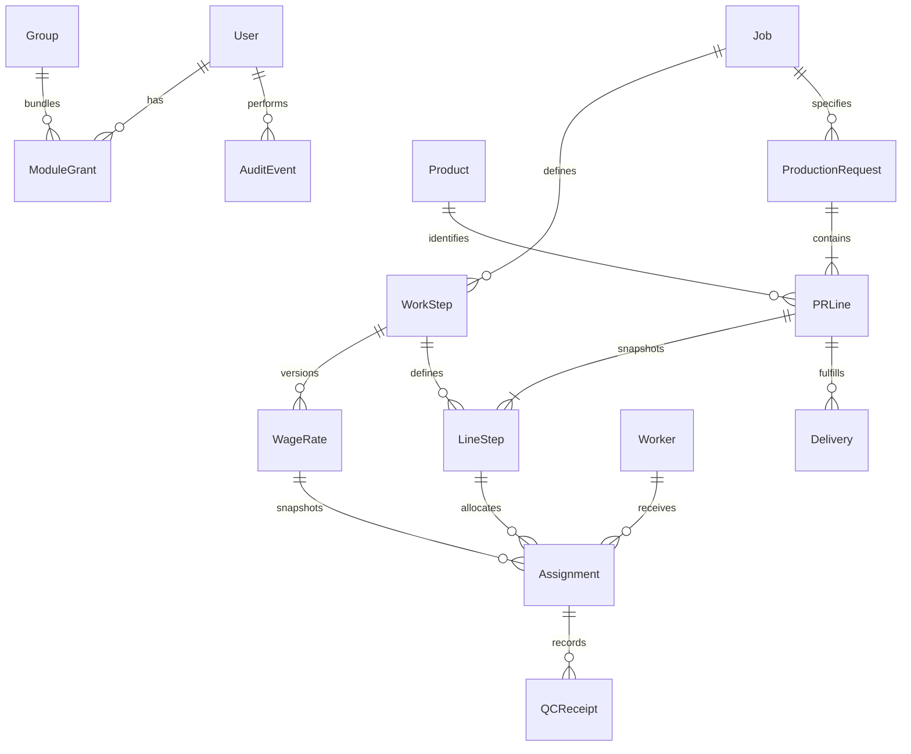

# First release design and requirements matrix

The supplied v1.2 specification is preserved in `requirements.md`. Its authoritative first implementation (section 0.10) defines this release. Later inventory, cutting, materials, fixed costs, invoice/payment accounting, historical migration and Odoo are explicitly unreleased. No source spreadsheets were accessed or historical records fabricated.

## Plan and implementation

1. Foundation: Django authentication/sessions, explicit module/action grants, invitations, revocation, audit.
2. Master data: products, reusable jobs, patterns/work steps, versioned wages, workers.
3. Module 1: draft PR with multiple product/size lines; post to snapshot required steps; assignments, partial QC, deliveries and reversals; filtered dashboard/report/CSV/JSON.
4. Validate on PostgreSQL 17.11, then package Docker/CI and document deployment gates.

All business primary keys are UUIDs, not concatenated labels. Module grants and line-step links use relational keys. Quantities are integer garment pieces; wages are Decimal(14,4), THB per piece. UTC event timestamps are displayed in Asia/Bangkok. PO is a reference field only in this release, not a claimed PO approval system. Product sizes are typed line attributes initially; a reusable variant catalogue is incremental scope.

## Transaction rules

- PR header/lines can be edited only in draft; existing source links are immutable. No delete endpoint. Posting freezes the job's current active work-step set on every line. Posting again does not change it.
- Work-step rate applicability uses `[effective_from, effective_to)`, exact price type and assignment business date. Missing or ambiguous rates block posting. Zero is explicitly a free rate; absent rates are never treated as zero. No automatic tax interpretation or supplier-specific override.
- Wage amounts/price-version references are copied onto assignments. Rate edits cannot recalculate historical snapshots. New price versions require a nonoverlapping interval; used dates cannot be removed by shortening a period. Amounts of existing versions have no edit endpoint.
- Mutations lock PR, line, assignment as needed in a consistent order. Per-line locks serialize allocations, QC and delivery. Price mutations/assignment selection lock the work step. Ledger mutations have unique idempotency keys and replay payload validation; PR uniqueness also prevents duplicate browser submissions.
- Per step: available = requested − assigned + terminal rejected; with worker = assigned − accepted − terminal rejected. Rework remains with worker and may be received/QC'd again. `received_attempts` includes repeat rework attempts and is not unique completed garments. Reject/rework requires a reason. No financial payable quantity is implied by this operational classification.
- Delivery requires QC acceptance across **every frozen step**: available to deliver = minimum accepted across steps − net delivered. Partial delivery never closes the PR. Explicit close requires all lines fully delivered and nothing with workers. Cancellation requires no accepted/delivered work and nothing with workers.
- Posted assignments/QC/deliveries have no edit/delete endpoints. Authorized reversal retains original data, actor/reason/time in audit; it is rejected if it would invalidate later allocations or deliveries. Closed/cancelled PRs are immutable in this release; reopening is deferred and needs policy approval.
- SourceIdentity keeps explicit source/entity/string-ID → typed UUID links, plus raw metadata slots. The manual-entry namespace does not assert a full migration map. Duplicate IDs mapping to different lines are rejected for review. Source exports and reconciliation are outstanding.

## Permissions

Deny by default. Each request queries current user + group grants from SQL (additive union), with active superusers as controlled administrators. Only released module keys can pass checks. No permission cache in sessions. `read` does not imply any mutation/export/financial/lookup permission.

Work pages require `work.read`; draft create requires `create` + `lookup_catalog`; draft edits require `update_draft` + `lookup_catalog`; assignment/QC/delivery/post/close require `post` (assignment also needs `lookup_catalog`); corrections require `reverse`; CSV requires `read` + `export`. `work.read_financial` reveals snapshot wages and **reference value only**, not payable liabilities. Catalogue wages require `catalog.wages.read` + `read_financial`; price changes additionally require create/update_draft + manage_prices. Catalogue edit rights are independent from work rights. Shared worker masters live under work read/create/update_draft.

Admin account control and grant control use separate `admin.manage_users` / `admin.manage_permissions`. Non-superusers cannot modify superuser accounts or mint grants they do not hold. Group membership changes likewise require authority over changed grants. The last active superuser cannot be disabled; superuser promotion/demotion is intentionally available only through trusted Django CLI operations. `admin.read` exposes audit metadata; payloads additionally require `admin.read_financial`, since they may include rate edits. Roles can be composed in the Admin role screen; no actual staff identities or grants are seeded.

Login throttling: per normalized account AND per direct client address, five attempts per 15-minute window. Successful attempts count toward the window; this intentionally favors a conservative small internal team baseline. Forwarded client-address headers are not trusted. Behind ALB the address bucket can aggregate clients; a verified proxy-aware IP policy/WAF rule is a production gate. Database sessions expire eight hours after login, logout is POST/CSRF-protected. Account disablement/permission revocation applies at the next request; explicit session revocation increments a DB version and logs out all existing sessions at their next request. Password changes/resets use Django session-auth hashes. Invitations expire in one hour using Django tokens, deliver through SMTP, and grant no module access. No public registration or first-visitor admin creation.

## Scope / acceptance status

| Requirement | Implemented first release | Remaining gate |
|---|---|---|
| AUTH-01–05 / 0.9 | Session auth, server permissions, financial filtering, controlled bootstrap, roles, revocation, CSRF, throttle | Actual identities, production SMTP/HTTPS and security review |
| ORD-01–03 | Multiple sizes/lines, string source IDs, partial delivery, stable FK and rate snapshot | Separate PO approval lifecycle deferred |
| WORK-01 | Per-line/per-step capacity; PostgreSQL concurrent assignment and QC tests | Staff operational trial |
| WORK-02 | Partial accepted/rejected/rework with traceable receipts; no assumed payable amount | Owner must confirm wage recognition and reject/rework policy |
| Catalogue rates | Versioning, overlap validation, effective-date selection, frozen applied wages | Selling/job prices, supplier dimensions/tax conventions deferred |
| DATA-01–02 | SQL records/sessions, Thai/punctuation, CSV, API; browser and replacement checks | Real second-device UAT |
| OPS-01 | Backup/restore procedure and current-instance round trip | Production RDS point-in-time recovery drill |
| PAY / FAB / COST | Module boundaries, stable PR-line UUID, unavailable navigation | Later releases, not claimed implemented |
| MIG | Source-ID crosswalk foundations only | Source exports, reviewed staging/imports/reconciliation/cutover |

## Unresolved business decisions

Wage recognition is **not configured**: no invoice, settlement or payable total is generated. Applied rate and accepted-work reference value can be viewed by explicitly authorized users. The operational reject/rework calculation above needs owner acceptance before cutover. One shared workspace includes PPD/GPT context labels; these are **not company isolation**. If legal separation is required, company membership/scoping must precede live data entry. Other questions: VAT/currency semantics, staff grants/approval matrix, source-ID meanings/duplicates, batch/roll/units policy, cost-allocation basis and migration cutover. Later modules remain disabled until their predecessor is validated.
